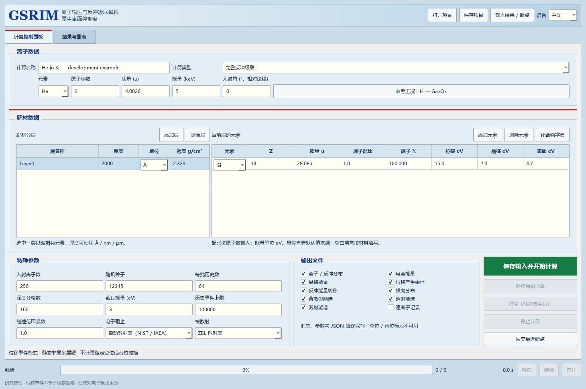
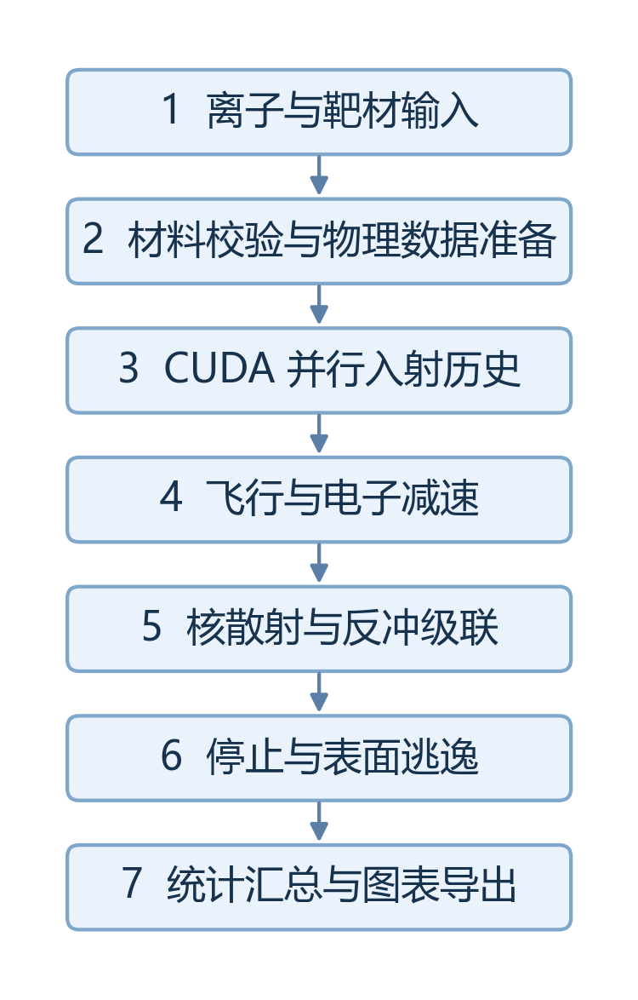

# GSRIM

**基于 CUDA 的离子输运与反冲级联蒙特卡洛模拟系统**

GSRIM 使用 GPU 并行跟踪离子进入材料后的减速、偏转、碰撞和反冲级联，提供中英文原生桌面界面，用于设置多层靶材、运行模拟、查看分布并导出结果。



## 主要功能

- **离子与多层靶材设置**：选择入射元素、质量、能量和角度；配置层厚、密度、元素组成与原子配比。
- **逐元素参数建议**：提供 H～U 共 92 种元素的来源标注；位移、晶格和表面能量可编辑，缺失值提示补充。
- **GPU 输运与反冲级联**：基于二体碰撞近似，支持仅离子输运或反冲级联两种模式。
- **多种阻止与散射方式**：ZBL 势散射、LS/BV 电子阻止、可选 NIST/IAEA 数据表，以及查表和数值求积。
- **科学图表**：停止分布、能量沉积、位移事件、横向分布、逃逸能谱与入射轨迹；射程图显示平均射程、展宽、偏度和峰度。
- **运行管理**：进度与批次统计、暂停、继续、停止、NPZ 断点和项目保存。
- **数据输出**：PNG/BMP 图表、科学文本、JSON/CSV、可选逐历史记录，以及外部参考表独立查看。

## 快速开始

### 运行环境

- Windows 10/11，64 位 Python **3.12**。
- 支持 CUDA 12 的 NVIDIA GPU，以及兼容的 NVIDIA 驱动。
- 桌面界面使用 Qt Widgets，直接运行，无需浏览器或 WebView。

依赖文件包含 CuPy、CUDA Runtime 与 NVRTC。正常使用源码版无需另外安装完整 CUDA 开发工具包；显卡驱动需要由使用者安装。

### 安装并启动

在 PowerShell 中执行：

```powershell
git clone https://github.com/wepar1212/GSRIM.git
cd GSRIM
py -3.12 -m venv .venv
.\.venv\Scripts\python.exe -m pip install -r requirements-desktop.txt
.\.venv\Scripts\python.exe -m gsrim.desktop
```

安装完成后，也可以双击根目录的 **Start-GSRIM.cmd**。首次计算需要编译 CUDA 内核并准备散射表，后续会复用缓存。

### 完成第一次模拟

1. 启动后保留默认的 He → Si 工况，或自行设置离子与靶材。
2. 选择入射历史数、随机种子、阻止模型和散射方式。
3. 点击“保存输入并开始计算”，在结果页查看曲线与摘要。
4. 使用“保存图表”或“导出结果文件夹”保存结果；每次导出建立独立目录。

右上角可以切换中文 / English，当前输入与运行状态保留。

## 计算流程



系统以静态非晶平面分层靶为对象。ZBL 描述原子间的屏蔽排斥；LS/BV 或适用的数据表描述电子减速；蒙特卡洛抽样决定碰撞距离和几何；CUDA 同时处理许多独立入射历史。

输出中的位移数表示位移产生事件；图中四项射程统计取自停止在靶内的原始入射离子终点。

## 数据与结果

不安装外部数据也可以完成默认模拟：自动模式会在缺少适用数据时使用解析阻止模型。需要使用 NIST/IAEA 数据时，按 [数据说明](data/README.md)放置文件。

结果中记录实际采用的阻止来源。results/ 保存运行记录、断点与缓存；文本和图片通过结果页导出。常见输出包括：

| 输出 | 内容 |
| --- | --- |
| `RANGE.txt` | 入射离子与停止反冲的深度分布 |
| `IONIZ.txt`、`PHONON.txt` | 电子与晶格能量沉积 |
| `DISPLACEMENTS.txt` | 位移产生事件分布 |
| `BACKSCAT.txt`、`TRANSMIT.txt`、`SPUTTER.txt` | 背散射、透射与溅射能谱 |
| `project.json`、`result.json`、`profiles.csv` | 输入、结果快照与分箱数据 |

## 文档

- [通俗原理说明](docs/基于%20CUDA%20的离子输运与反冲级联蒙特卡洛模拟系统设计与实现.md)：从粒子进入材料讲起，解释 LS、BV、ZBL、蒙特卡洛和 CUDA。
- [架构与数学原理](docs/项目架构与原理说明.md)：完整计算链、公式和 CPU/CUDA 分工。
- [桌面使用与输出](docs/NATIVE_DESKTOP.md)：控制面板、图表、断点和导出。
- [元素参数来源](docs/ELEMENT_DEFAULTS.md) / [参数表](docs/element-defaults.csv)。
- [外部阻止数据](data/README.md)与[本地独立包构建](build/README-DESKTOP.md)。

## 开发与测试

```powershell
# CPU、参数、输出与接口回归
.\.venv\Scripts\python.exe -B run_tests.py

# 包含 CUDA 与小规模输运的回归
.\.venv\Scripts\python.exe -B run_tests.py --gpu
```

测试使用临时目录，不覆盖应用断点。CPU 测试可只安装 `requirements.txt`；完整模拟使用 NVIDIA GPU。可选网页入口 `python -m gsrim.server` 继续保留。

## 许可证

项目源码采用 [MIT License](LICENSE)。依赖组件与数据来源说明见 [THIRD_PARTY_NOTICES.md](THIRD_PARTY_NOTICES.md)。
