# 基于 CUDA 的离子输运与反冲级联蒙特卡洛模拟系统设计与实现

> **GSRIM 通俗原理说明** 
> 面向没有离子输运、材料物理或 GPU 编程背景的读者。 
> 本文解释物理原理与系统实现逻辑，不介绍具体代码。少量公式都配有文字解释，可以先读文字，再看公式。 
> 整理日期：2026-10-27。

## 一、这套系统究竟想回答什么问题

设想用一束高速粒子轰击一块材料。这些粒子进入材料后，并不会整齐地走直线、停在同一个深度。它们会一路减速，也会被材料中的原子改变运动方向；有的留在内部，有的从表面折返，有的穿透薄膜，还有的把材料原子撞出去。

GSRIM 要在计算机里重建这些过程，并回答几个问题：

- 入射粒子通常能够进入多深，停止位置有多分散？
- 有多少粒子被反射回来，有多少穿过材料？
- 能量主要交给了电子，还是交给了材料原子的运动和晶格？
- 一次入射会撞动多少靶原子，又可能带出多少表面原子？

可以把它理解成一座“计算机里的粒子轰击实验台”。使用者设定离子、能量、角度和材料层，系统依据选定的物理模型生成许多可能的运动经历，最后给出统计图表。

例如，输入“40 keV 的氢离子进入氧化镓”，首先只是规定了一种计算工况，并没有预先规定它一定停在什么位置。最终分布需要由减速、碰撞和反冲过程共同决定。

## 二、先把标题中的几个词拆开

| 名词 | 通俗解释 |
| --- | --- |
| **离子** | 带电的原子或原子团。本系统按单原子粒子处理，不跟踪分子的解离过程 |
| **靶材** | 被轰击的材料，可以由一种或多种元素组成，也可以分成多层 |
| **输运** | 跟踪粒子的位置、运动方向和能量怎样随运动而改变 |
| **反冲** | 原来属于靶材的原子被撞到后，获得动能并开始运动 |
| **级联** | 被撞动的原子继续撞动其他原子，形成一连串有先后关系的碰撞 |
| **蒙特卡洛** | 按物理概率反复抽样，用大量可能经历来估计总体规律的方法 |
| **CUDA** | NVIDIA 提供的 GPU 并行计算平台，让计算机能够同时处理许多类似的计算任务 |

“一条入射历史”是后文经常使用的说法：**它包含一个原始入射离子，以及这个离子引发并被系统跟踪的全部反冲粒子。** 它不是只包含一段直线，也不一定只有一次碰撞。

下文的 eV、keV 都是能量单位，1 keV 等于 1000 eV；nm 和 Å 都是长度单位，1 nm 等于 10 Å。能量、速度和进入深度有关联，但不是同一个量。

## 三、离子为什么会慢下来：两条不同的能量去向

材料中既有原子核，也有电子。运动粒子与这两部分相互作用的结果不同，系统把它们分开处理。

### 3.1 与电子相互作用：沿途持续损失能量

离子通过材料时，会扰动电子，使电子受到激发，或者使电子脱离原来的束缚状态。离子为这些过程付出能量，自己逐渐减速。

这种损失称为**电子阻止**。这里的“阻止”表示削减粒子的动能，并不表示粒子马上停止。

可以借助“运动时受到阻力”的经验来理解，但它不等同于宏观物体与空气的摩擦。真实原因是运动粒子与材料电子之间的微观相互作用。

### 3.2 与原子核相互作用：改变方向，并转移动能

粒子接近某个靶原子时，双方之间的相互作用会改变运动方向，并可能把一部分动能转交给靶原子。获得足够能量的靶原子随后也会运动。

这部分通常称为**核阻止或核碰撞能量损失**。“核”指相互作用主要涉及原子核的运动，不是说发生了核裂变或核聚变。本系统不模拟这些核反应。

台球碰撞可以帮助理解动能转移，但原子并不是两颗必须接触表面才碰撞的硬球：它们会在一定距离上通过相互作用力改变轨迹。

| 过程 | 主要回答的问题 | 本系统如何描述 |
| --- | --- | --- |
| 电子阻止 | 沿途交给电子系统多少能量？ | LS、BV 或适用的数据表 |
| 核碰撞 | 方向偏了多少、靶原子获得多少动能？ | ZBL 势配合经典二体碰撞关系 |

这两部分必须分账，否则可能把同一份损失重复扣除。

## 四、ZBL：两个原子靠近时，怎样相互排斥

### 4.1 为什么需要一种“势”

物理中的**相互作用势**，可以理解成一张规则图：两个粒子相距多远时，彼此的相互作用有多强。给定这张图，再结合双方质量、入射能量和靠近的程度，就能求出碰撞后的方向及能量转移。

原子核带正电，两个原子核之间存在排斥；但原子周围还有电子，电子会减弱外界感受到的核电作用。这种减弱称为**屏蔽**。

屏蔽不是盖上一块完全挡住作用力的板，而是把“两个裸露原子核之间的作用”修正为“带有电子环境的原子之间的有效作用”。

### 4.2 ZBL 是什么

**ZBL 是 Ziegler–Biersack–Littmark 的缩写**，取自提出这一通用屏蔽势的研究者姓氏。它用一套统一的近似关系描述不同元素之间的短程排斥。

在 GSRIM 中，ZBL 用来回答：这次原子靠近会引起多大散射角。然后，系统再利用质量和碰撞守恒关系计算转移动能。

读者只需先记住：**ZBL 负责描述原子间的作用，进而帮助计算“怎样撞、往哪偏”。** 它不直接给出整条离子的最终射程，也不负责全部电子阻止。

### 4.3 相同入射能量，为什么每次碰撞不同

除了元素和质量，还要考虑**碰撞参数**：如果暂时忽略相互作用，粒子原本会从靶原子旁边偏离多远的位置通过。

通常，靠得越近，发生较大偏转和能量转移的机会越大；远一些掠过，影响可能较弱。具体数值仍要由相互作用势和碰撞关系求得。

当前 GSRIM 固定采用 ZBL 势。“散射表”和“数值求积”是求同一个 ZBL 模型结果的两条数值路线：前者事先算好许多点再查表，后者按当前碰撞条件求积分。它们不代表两种不同的材料物理定律。

## 五、LS 与 BV：沿途交给电子多少能量

### 5.1 先认识“阻止本领”

**阻止本领**表示粒子每前进单位距离，平均损失多少能量。阻止本领越大，同样走一段路，粒子损失的能量通常越多。

用一个关系表达：

$$
\frac{\mathrm dE}{\mathrm ds}=-S_{\mathrm e}(E).
$$

这里，$E$ 是粒子的动能，$s$ 是走过的路程，$S_{\mathrm e}$ 是电子阻止本领。负号只表示能量沿运动过程减少。

关键之处是：**阻止本领一般不是常数，会随着粒子速度、元素和材料环境改变。** 因此，粒子刚进入材料与快停下来时，不能简单套用同一个固定“减速值”。

### 5.2 LS：低速条件下的一种电子减速近似

**LS 指 Lindhard–Scharff 模型。** 在适用的低速条件下，它把电子阻止近似为与粒子速度成正比。对于给定质量，动能与速度的平方有关，因此常写成：

$$
S_{\mathrm{LS}}(E)=k\sqrt E.
$$

不必记住系数怎样推导。可以这样理解：在这个近似适用的范围内，粒子速度变了，交给电子的能量损失也随之改变。系数 $k$ 则综合了运动粒子、靶元素、质量和材料数密度等因素。

**“低速”取决于粒子的质量等条件，不能把某个固定总能量当作所有元素共同的准确分界。** LS 也不是对所有材料、所有能量都精确的公式。[原始论文：Lindhard 与 Scharff，1961](https://doi.org/10.1103/PhysRev.124.128)。

### 5.3 BV：把不同能区的电子减速关系连接起来

**BV 指 Biersack–Varelas 型连接方法。** 它利用低能端和较高能端的近似，构造一条覆盖更宽能区的阻止曲线。本项目的高能端采用 Bethe 型关系，即一种描述高速带电粒子向材料电子转移能量的近似。

可以把 LS 想成擅长描述某一段路况的规则，BV 则试图把不同路况下的规则接成一条可用的曲线。

但“连接”不是把低能损失和高能损失各扣一次。它是在不同近似之间形成一个阻止值，之后只按这个阻止值扣除电子能量。

当前 GSRIM 在 BV 连接之外，还增加了让低能段更靠近 LS 的混合处理。**这是项目采用的一种模型选择，尚不能称为已经证明更准确的物理改进。**

真实离子在运动中可能失去或俘获电子，因此它对外表现出的电荷会变化，这涉及**电荷态**。本项目没有单独逐步求解这种动态变化。元素的原子序数则是核中的质子数，不能把它和离子此刻缺少多少电子混为一谈。

### 5.4 有数据表时，还需要这些公式吗

需要。NIST 和 IAEA 等机构提供的相关数据，只覆盖某些粒子、材料和能量范围。

- **NIST：美国国家标准与技术研究院。** 其 PSTAR、ASTAR 分别提供质子、氦离子相关阻止与射程数据，包含理论与实验依据，并非每个表值都来自一次直接测量。[NIST 数据说明](https://physics.nist.gov/PhysRefData/Star/Text/programs.html)。
- **IAEA：国际原子能机构。** 其数据库汇集已发表的电子阻止测量数据；数据适用对象和覆盖范围取决于具体实验。[IAEA 数据库说明](https://www-nds.iaea.org/stopping/)。

本项目的自动模式会优先寻找适用的本地数据：H、He 在单元素靶中先尝试 NIST，再考虑 IAEA。没有合适数据，或者能量超出所选表的覆盖范围，就使用解析模型补齐。

所谓**插值**，就是在已有数据点之间估计一个值；所谓**回退**，就是数据不足时，换用预先约定的解析近似。运行时不会自动上网找论文。

选择了某张表，也不意味着超出范围后会再遍历所有其他数据库。当前逻辑通常回退到解析模型；表与公式的交界处没有额外保证数值和斜率完全接合，仍需审视拼接误差。

### 5.5 化合物中的 Bragg 加和是什么意思

氧化镓由镓和氧组成。最简单的近似是先考虑各组成元素的电子阻止贡献，再按照它们在实际材料中的原子数占比和原子密度加起来。这称为 **Bragg 加和**。

注意，“氧原子占多少”与“氧占多少质量”不是同一个比例。一个重原子与一个轻原子的质量不同，不能直接把质量百分比当成原子抽样概率。

Bragg 加和便于处理混合材料，但没有完整描述化学键和材料相态带来的修正。因此，知道组成和密度，不等于已经精确知道该化合物的阻止曲线。

## 六、反冲级联：一个原子被撞动后，为什么还要继续算

### 6.1 从一次碰撞长出一串后续碰撞

入射粒子把动能交给某个靶原子后，这个原子也可能成为新的运动粒子。它会继续减速、偏转，并可能再撞动别的原子。

可以把这个过程想成一棵逐渐分叉的树：原始离子是起点；每个被跟踪的反冲原子都是一个分支。分支不一定沿同一方向，也不一定拥有足够能量继续产生新分支。

**级联不是凭空放大能量。** 粒子数量可以增多，但它们分到的能量来自原始入射粒子，并不断有能量交给电子和晶格。

### 6.2 三个容易混淆的材料能量参数

| 参数 | 它回答什么问题 | 在当前系统中的作用 |
| --- | --- | --- |
| **位移阈能 $E_d$** | 这次碰撞给靶原子的能量，是否达到计作位移事件的门槛？ | 达到门槛才进入对应的位移和反冲处理 |
| **晶格结合能 $E_l$** | 把原子作为反冲粒子释放出来时，给结合过程留出多少能量？ | 反冲可用动能按转移动能减去此项计算 |
| **表面结合能 $E_s$** | 原子从材料表面逃出去时，要跨过多大的能垒？ | 判断表面反射、逃逸，并扣除逃逸所需能量 |

这三项不能相互代替。尤其是：**位移阈能是判断门槛，不是达到门槛后还要再扣掉的一笔固定能量。**

另有一个**跟踪截止能量**：粒子能量太低时，系统停止继续追踪，把剩余动能记入模型的晶格沉积。它是一项计算近似，不等于位移阈能，也不表示真实原子从此完全静止。

### 6.3 用一笔小账说明反冲怎样分能量

下面只用假设数字说明计算逻辑，**不是某种真实材料的默认参数，也不是模拟结果**。设碰撞双方质量相同，某次允许的碰撞发生了如下过程：

1. 入射粒子起初有 **100 eV** 动能。
2. 飞行途中交给电子 **10 eV**，还剩 **90 eV**。
3. 碰撞把 **30 eV** 转移给靶原子，原入射粒子剩下 **60 eV**。
4. 假设位移阈能为 **25 eV**，这次转移达到门槛。
5. 假设晶格结合能为 **3 eV**，新反冲粒子可获得 **27 eV** 动能；若超过跟踪截止能量，就继续跟踪它。

此时的能量账本是：

| 能量所在位置 | 数值 |
| --- | ---: |
| 已交给电子系统 | 10 eV |
| 已计入结合过程的晶格沉积 | 3 eV |
| 原入射粒子的剩余动能 | 60 eV |
| 新反冲粒子的动能 | 27 eV |
| **合计** | **100 eV** |

不能再从这笔账里扣一次 25 eV 的位移阈能，否则就把“是否跨过门槛”和“实际付出多少能量”混为一谈。

### 6.4 位移事件为什么不等于最终留下的缺陷

原子曾被撞离原位置，不代表很久以后一定留下一个空位。真实材料中，原子可能返回、与别的缺陷复合，或者受到后续温度和结构变化影响。

GSRIM 当前主要统计**位移产生事件**，没有完整追踪这些长期恢复过程。因此，不能把图上的位移数直接解释成最终稳定缺陷数，也不能据此直接预测材料寿命。

## 七、蒙特卡洛：随机不意味着随便猜

### 7.1 哪些事情需要抽样

在无序材料近似中，我们通常不知道每个入射粒子会从哪一个原子旁边掠过。因此，系统依据概率抽样决定：

- 在当前材料里，接下来飞多远才遇到一次被模型计入的碰撞；
- 多元素材料中，这次遇到哪种靶原子；
- 从该原子旁边掠过多远；
- 碰撞发生在运动方向周围的哪一个方位。

例如，理想化的 Ga₂O₃ 成分中，氧和镓的原子数比是 3∶2。当前抽样逻辑依据原子比例选择碰撞对象，不是让所有元素各占一半，也不是按原子质量来选。

位置和碰撞几何可以随机抽样，**碰撞后怎样分能量仍必须遵守选定的物理关系**。不能因为使用了随机数，就允许无缘无故增加能量。

### 7.2 为什么不能只算一个离子

一个离子停得浅，可能只是它碰巧经历了一次很强的偏转。另一个离子停得深，也可能只是一路遇到的碰撞比较轻。

许多条历史合在一起，才能估计“通常怎样”和“波动多大”。这和抛一次硬币不能判断正面概率是同样的统计道理。

在相互独立、分布有合适统计性质等条件下，把历史数增加到原来的四倍，均值的随机标准误通常约降到一半。它不能消除错误的材料参数或不合适的物理模型造成的系统偏差。

### 7.3 随机种子能保证什么

随机种子可以理解成随机数序列的起点。在模型、算法、参数和实现条件保持一致时，它有助于复现计算。

同一个数字作为种子，并不能让 GSRIM、RustBCA 和 SRIM 自动生成相同轨迹：它们可能使用不同的随机数发生方式，也可能在一次碰撞中抽取不同次数的随机数。

## 八、一次模拟从输入到结果，怎样完成

```mermaid
flowchart TD
    A["输入离子、能量、角度和靶材"] --> B["检查参数并准备物理曲线"]
    B --> C["创建许多独立的入射历史"]
    C --> D["判断下一段先遇到什么事件"]
    D --> E["沿这段路程移动，并计算电子减速"]
    E --> F{"到达的事件"}
    F -->|"碰撞"| G["计算偏转、动能转移和可能的反冲"]
    G --> D
    F -->|"层界面或表面"| H["换层、表面反射或逃逸"]
    H --> I{"当前粒子还需跟踪吗"}
    I -->|"需要"| D
    F -->|"达到跟踪截止"| J["记录停止及剩余能量"]
    I -->|"不需要"| K["继续处理尚未完成的反冲粒子"]
    J --> K
    K -->|"还有反冲"| D
    K -->|"本条历史结束"| L["汇总所有历史，生成图表与报告"]
```

### 第一步：把材料描述清楚

系统需要知道每层多厚、密度是多少、有哪些元素、原子比例是多少。

密度和组成共同决定单位体积大约有多少原子，即**原子数密度**。质量密度相同的两种材料，因为原子质量不同，单位体积原子数也可能不同。

这里采用静态非晶材料近似。**非晶**表示不按长程规则排列的晶体结构来处理；**晶格**则指晶体中原子的规则排列。系统不搭建逐个可见的晶格原子阵列，而是依据材料的统计性质处理遭遇。反冲原子被跟踪，并不意味着背景材料会自动随着每次碰撞重新排列、改变厚度或成分。

### 第二步：准备减速与散射规则

先确定电子阻止采用什么来源，准备各类运动粒子在各层材料中的阻止曲线。反冲粒子也有自己的元素和质量，因此同样需要减速关系。

如果采用散射表，还会事先准备 ZBL 的散射关系。查表可以减少反复求解相同关系的工作，但会引入插值近似；直接求积也有数值精度限制。

### 第三步：给入射粒子一个初始状态

初始状态包括位置、方向、元素、质量和动能。入射角按相对材料表面法线的角度理解：0° 表示垂直进入表面，而不是沿表面滑过。

### 第四步：决定这一步走多远

系统会比较三件事：按当前抽样距离何时发生碰撞、何时到达层界面，以及何时因电子减速降到跟踪截止。

**谁先发生，就先处理谁。** 不能已经跨进下一层，还沿用上一层的材料规则走完整段路程。

当前自由飞行抽样依据数密度和有限的碰撞范围构造；ZBL 则用于求碰撞的偏转。两者承担不同角色，不能把下一次碰撞的距离理解为仅由 ZBL 势直接给出。

### 第五步：沿途减速，再处理到达的事件

在这一段运动中，先依据电子阻止关系计算损失并更新位置、能量。到达碰撞事件时，再计算核碰撞的偏转和能量转移；到达边界时，则处理换层或表面过程。

这是一种把连续减速与离散碰撞结合起来的数值近似，并没有逐一模拟每个电子的真实运动。

### 第六步：产生反冲，并跟踪全部后续粒子

符合当前位移门槛和能量条件时，把反冲原子加入需要继续跟踪的粒子中。它随后经历相同类型的飞行、减速、碰撞和边界判断。

原始离子已经停止，也不表示这条历史已经结束：只要它引发的反冲仍在运动，相关级联就还需要处理。

### 第七步：判断停止、反射、透射和溅射

| 结果 | 含义 |
| --- | --- |
| 停止在靶内 | 运动粒子降到跟踪截止条件，剩余动能按模型记入晶格沉积 |
| 入射离子背散射 | 原始入射离子最终从入射侧表面离开 |
| 入射离子透射 | 原始入射离子从靶材背面离开 |
| 表面溅射 | 原先属于靶材的原子获得动能，并从入射侧表面逃出 |

对有表面能垒的反冲原子，当前模型关注其**朝表面外法线方向的动能分量**是否足以跨越能垒。即使总动能不少，运动方向几乎平行表面时，也未必能逃逸。

这里的表面结合参数主要用于靶反冲原子，不能直接套成所有入射离子的共同逃逸门槛。

### 第八步：核对能量，并统计总体规律

每条历史结束时，要核对入射能量最终去了哪里。对于完整结束、没有异常的历史，主要应能分到电子沉积、晶格沉积和逃逸粒子携带的能量中。

如果碰撞次数或需要跟踪的粒子数量触及计算上限，仍未处理完的能量要记为未解析部分，并标记异常。它不能为了让图表好看，就被当成正常晶格沉积或正常停止粒子。

之后，系统才把许多条历史合并成平均值、分布曲线、比例和产额。

## 九、CUDA 在其中究竟做了什么

### 9.1 适合并行的是许多条独立历史

在当前静态靶近似下，一条入射历史不会改变下一条历史使用的材料背景。因此，可以让许多条历史同时计算，再把结果汇总。

这与真实高剂量照射中“前面的粒子逐渐改变后续粒子所见材料”并不是同一种模型。后者涉及材料成分、结构或表面的动态演化，当前系统没有完整实现。

CUDA 提供利用 NVIDIA GPU 执行这类并行任务的能力；其通用定位可见 [NVIDIA 官方说明](https://docs.nvidia.com/cuda/cuda-programming-guide/index.html)。

### 9.2 三部分怎样分工

| 阶段 | 在本系统中的职责 | 通俗理解 |
| --- | --- | --- |
| **CPU：计算前** | 检查输入，确定材料数密度和层边界，选择数据与模型，准备阻止及散射关系 | 先准备实验条件和计算规则 |
| **CUDA / GPU：逐粒子计算** | 抽样飞行和碰撞，计算电子减速、散射、反冲级联、表面过程，累计原始计量 | 同时重建许多条粒子经历 |
| **CPU：计算后** | 合并计量，计算射程、展宽、偏度、峰度及归一化结果，绘图和保存 | 把许多经历整理成可读报告 |

因此，“程序基于 CUDA”不表示输入检查、所有数学处理和图表绘制都在 GPU 中完成。

一条历史内部仍必须遵守因果顺序：先有碰撞转移，才能知道新反冲拥有多少能量；先有新反冲，才能继续它的运动。CUDA 并行不能打乱这个先后关系。

### 9.3 加速了什么，没有自动改善什么

GPU 并行的目标是减少完成许多历史所需的时间，或在允许时间内完成更多历史。事先准备散射表和“能量能走多远”的积分关系，也可以减少逐步计算中的重复工作。这里的积分可以先理解为把连续过程中的许多小份变化累加起来，建立能量与路程的对应关系。

但 GPU 不会自动修正错误的材料参数，也不会把不适用的近似变成精确物理。**多算历史有助于降低抽样噪声，模型是否合适仍要另行判断。** 本文不据此宣称具体加速倍数。

## 十、结果图上的数字应该怎样读

### 10.1 射程是向深处的距离，不是总共走过的路

粒子可能左右偏转、绕行一段路，最后只进入材料很浅的位置。因此，“从表面向深处投影了多少”与“曲折轨迹一共多长”需要分开。

本系统离子分布图的四项统计，使用**停止在靶内的原始入射离子终点**。背散射、透射离子和靶反冲原子不混进这组统计。

| 图上统计量 | 通俗含义 | 容易产生的误解 |
| --- | --- | --- |
| **平均射程 / Ion Range** | 停止离子沿深度方向，平均进入了多远 | 不代表每个离子都停在那里，也不是轨迹总长 |
| **射程展宽 / Straggle** | 停止深度的分散程度，用标准差表示 | 不等于均值的测量误差；历史增多也不会让真实分布必然变窄 |
| **偏度 / Skewness** | 分布是否向某一侧拖出较长尾巴；深度轴向右增加时，正值偏向深侧长尾，负值偏向浅侧长尾 | 接近零不代表一定是正态分布 |
| **峰度 / Kurtosis** | 描述分布尾部与极端偏离情况的四阶统计量；本系统以正态分布为 3 | 不是图中最高柱子的高度，也不是减去 3 后的超额峰度 |

它们直接来自原始终点，不是从绘图柱子的中心估算出来。没有足够可用数据，或者所有深度相同而使高阶统计无法定义时，界面显示 N/A，而不是随意补一个数字。

### 10.2 深度分箱是什么

绘图时，把材料沿深度切成许多小区间，统计各区间中有多少停止粒子或多少能量沉积。这些区间称为**分箱**。

分箱较细时，细节更多，但每箱样本更少，柱子可能更不平滑；分箱较粗时，曲线更平滑，却可能掩盖细节。平滑与否不能单独作为物理准确性的判断依据。

### 10.3 能量图也有不同含义

- **电子能量沉积**：记入电子激发、电离等通道的能量。
- **晶格能量沉积**：按模型记入结合过程、低能粒子停止等通道的能量，不能直接读成材料温升或真实声子数。
- **累计碰撞转移动能**：把各次碰撞中转手的动能相加，同一份能量可能被连续转移多次，不能再与前两项一起当作互不重叠的最终去向。

例如，粒子 A 有 10 份能量，先给 B 7 份，B 再给 C 4 份。累计转移为 11 份，但此时 A、B、C 分别有 3、3、4 份，总能量仍然只有 10 份。累计转移超过初始能量，并不必然违反能量守恒。

### 10.4 从分布换算实际浓度，还缺一个量

标准分布按入射数量进行了归一化。要估算实际照射后的浓度，还需要**注量**：单位面积累计打入多少离子，常用单位为 ions/cm²。

注量不是每秒有多少离子的束流强度。在静态、线性叠加近似下，可以把归一化深度分布乘以注量估算浓度；高剂量下若材料已经明显演化，这个简单换算就可能不再适用。

## 十一、参数、算法与结果可信度怎样联系起来

### 11.1 参数不是全部与元素名称固定绑定

原子序数用于识别元素，质量还涉及同位素；位移阈能、结合能则会受材料结构、化学环境、表面状态以及采用的定义影响。

因此，“选择了硅”并不等于“所有含硅材料都应使用完全相同的三项能量”。系统提供的是有来源的起始建议，而不是对所有工况都成立的元素常数。

目前可选 H～U 共 92 种元素，部分参数没有适用建议值，需要按具体材料填写。某些晶格能采用明确标注的模型假设。缺失项与来源详见 [元素参数说明](ELEMENT_DEFAULTS.md)。

### 11.2 三类改变，解决的是三类不同问题

| 改变什么 | 主要影响什么 |
| --- | --- |
| 材料密度、组成、结合能等物理输入 | 模拟的实际对象与材料响应 |
| 相互作用势、电子阻止、反冲及表面处理模型 | 对真实过程采用哪一种近似 |
| 历史数量、截止条件、碰撞范围、插值精度等数值设置 | 抽样波动、数值近似和计算代价 |

增加历史数不能代替选对模型；换一组随机种子也不能修复错误的单位换算。反过来，结果略有变化，也不必然说明守恒关系出了错，需要先分清变化来自哪一类设置。

### 11.3 与 RustBCA、SRIM 的关系

GSRIM、RustBCA、TRIM 使用相关的二体碰撞模拟思想，但它们并不是同一份物理实现。GSRIM 参考了部分 LS/BV 处理关系，也采用领域通用的 ZBL 势和经典碰撞关系。

GSRIM 的反冲生成门槛、电子阻止拼接、数值求解和随机采样等细节，不应被默认看成与其他程序完全一致。它也没有完整复现 SRIM 的阻止参数和化合物修正体系。

项目目前能够展示的是一套独立的 GPU 输运与反冲级联计算流程。是否更接近实验，需要在明确材料、能区和输出定义后判断；不能仅凭界面相似、能量守恒或运行更快得出结论。BCA 软件的公开背景可参考 [RustBCA 论文](https://doi.org/10.21105/joss.03298)，离子在物质中阻止与射程的系统介绍可参考 [SRIM 作者的教材说明](https://www.srim.org/SRIM%20Book.htm)。

## 十二、系统实现到哪一步，哪些事情尚未包含

| 已有能力 | 应怎样理解 |
| --- | --- |
| 中英文原生桌面控制面板 | 输入离子、靶层、组成与运行设置，无需浏览器 |
| GPU 入射历史及反冲级联跟踪 | 在当前物理近似下计算粒子运动、沉积和逃逸 |
| 图表、摘要和分项输出 | 展示停止分布、四项统计、能量沉积与逃逸等结果 |
| 暂停、继续、断点和输出保存 | 保存计算进度与输入，便于同一兼容版本继续工作 |
| 参数来源与结果来源说明 | 区分材料建议、外部数据和解析回退 |

当前模型没有完整包含晶体沟道、退火与缺陷复合、靶材成分演化、化学溅射、完整替位过程和动态电荷态求解。有限碰撞范围、跟踪截止和数值插值也是近似的一部分。

本文对应仓库源码引擎 Revision 4。使用者可从源码启动原生桌面，或按构建说明生成自己的独立程序。安装与启动见 [项目 README](../README.md)。

## 附：阅读时可以随手查的术语表

| 术语 | 中文含义与阅读提示 |
| --- | --- |
| **BCA** | Binary Collision Approximation，二体碰撞近似；把复杂运动近似拆成一连串两粒子碰撞 |
| **ZBL** | Ziegler–Biersack–Littmark，描述原子短程作用的通用屏蔽势 |
| **LS** | Lindhard–Scharff，适用低速条件的一种电子阻止近似 |
| **BV** | Biersack–Varelas 型连接，把低能和较高能电子阻止近似连接起来 |
| **Bethe 型关系** | 较高速度条件下描述电子能量损失的一类理论近似；适用范围与修正项需要核对 |
| **Bragg 加和** | 根据各组成元素的贡献估算混合材料的阻止，不完整包含化学键修正 |
| **蒙特卡洛** | 依据概率反复抽样；随机经历受物理规则约束 |
| **反冲级联** | 靶原子被撞动后，再引发其他原子运动的连续过程 |
| **屏蔽** | 电子环境减弱外界感受到的核电作用 |
| **碰撞参数** | 忽略相互作用时，粒子原本会从靶原子旁边偏离多远的位置通过 |
| **散射角** | 描述碰撞引起的方向改变；数值计算中要区分质心系与实验室系，两者不是同一个角 |
| **质心系** | 随两个粒子的共同质心运动来观察碰撞；便于求碰撞关系，随后要换回材料所在的实验室视角 |
| **原子序数 $Z$** | 原子核中的质子数，用于识别元素；不等于正在运动的离子此刻失去了多少个电子 |
| **数密度** | 单位体积有多少原子，与单位体积有多少质量不同 |
| **eV / keV** | 电子伏特 / 千电子伏特，都是能量单位；1 keV = 1000 eV |
| **u** | 原子质量单位，表示原子质量；不是能量单位，也不是电荷数 |
| **Å / nm** | 埃 / 纳米，都是长度单位；1 nm = 10 Å |
| **截止能量** | 低于此值时停止继续跟踪的计算条件，不是材料位移阈能 |
| **注量** | 单位面积累计入射的粒子数，常用 ions/cm² |
| **CPU / GPU / CUDA** | CPU 组织准备与汇总，GPU 承担大量类似运算，CUDA 是本项目使用 GPU 的平台 |

需要进一步查看数学关系，可继续阅读 [项目架构与原理说明](项目架构与原理说明.md)；需要实际操作时，阅读 [原生桌面与输出说明](NATIVE_DESKTOP.md)。
