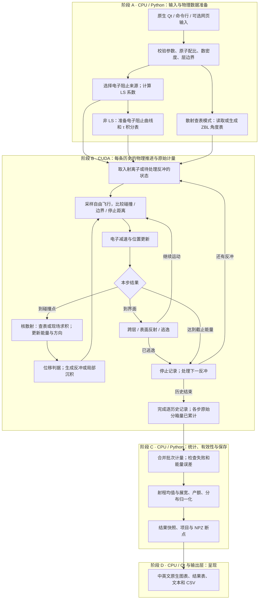

# GSRIM 项目架构与原理说明

> **从输入参数到离子射程：当前代码实际计算了什么**
>
> 核对日期：2026-10-27　｜　源码引擎：Revision 4<br>
> 交互入口：中英文原生 Qt 桌面、命令行、可选网页<br>
> 公式约定：行内使用 `$...$`，独立公式使用 `$$...$$`；适用于启用数学扩展的 Markdown 阅读器。

GSRIM 是一个独立实现的**蒙特卡洛二体碰撞近似离子输运程序**。输入入射离子、能量、角度和多层靶材后，程序逐步计算离子的减速、偏转、能量转移，以及由碰撞产生的反冲级联，最后统计射程、深度分布、背散射、透射和溅射。

本文对应仓库源码。桌面启动、命令行与本地打包方法见项目 README。

本文以当前源码为依据。重点是 CUDA 所执行的**物理与数学逻辑**：在哪里发生碰撞、一次碰撞转移多少能量、粒子朝哪里运动、何时产生反冲，以及如何把许多条历史变成结果图。线程、显存和编译等实现细节不在本文展开。

初次接触这些概念，可先阅读 [通俗原理说明](基于%20CUDA%20的离子输运与反冲级联蒙特卡洛模拟系统设计与实现.md)，再查看下文的公式与分工。

---

## 阅读导航

1. [项目全貌与当前文件结构](#overview)
2. [输入、坐标与符号](#inputs)
3. [CPU / CUDA 职责与计算链](#cuda-map)
4. [CUDA：碰撞位置与单步推进](#flight)
5. [电子阻止：CPU 准备，CUDA 减速](#electronic)
6. [核散射：CPU 建表，CUDA 求碰撞](#collision)
7. [CUDA：位移、反冲与表面过程](#cascade)
8. [CUDA 原始计量 → CPU 统计与输出](#statistics)
9. [运行、保存与验证](#workflow)
10. [物理边界与源码索引](#limits)

<a id="overview"></a>

## 1. 项目全貌与当前文件结构

### 1.1 按执行位置划分的计算链



实线给出数据和状态的主要流向。具体分支按所选模型启用：LS 使用解析减速；非 LS 使用积分表减速；散射查表模式才需要 ZBL 角度表，逐次求积模式直接计算散射积分。

深度箱和能谱计量在对应物理事件发生时累加；图中“完成逐历史记录”表示这条历史已经结束，不表示到最后才记录所有事件。

**先准备物理关系，再由 CUDA 推进粒子，最后由 CPU 汇总结果。** 表格的生成、射程均值和最终绘图都不属于粒子输运内核。

数学上，一次运行包含 $N$ 条入射历史。**一条历史**包含一个入射离子，以及该离子引起的所有被跟踪反冲粒子。原子反冲数量不计入输入中的“入射离子数”。

电子阻止数据和散射关系先被整理成可供计算使用的形式；输运过程依据这些关系，反复推进粒子状态：

$$
\mathcal{X}=(\mathbf r,\widehat{\mathbf u},E,s,\ell),
$$

其中 $\mathbf r$ 是位置，$\widehat{\mathbf u}$ 是单位运动方向，$E$ 是动能，$s$ 是粒子种类，$\ell$ 是所在材料层。

### 1.2 当前目录

项目采用以下目录结构，运行结果和构建产物在使用时生成，不随源码提交。

```text
GSRIM/
├─ gsrim/                 参数、材料、物理模型、统计与桌面入口
│  └─ kernels/            CUDA 输运与单次散射
├─ docs/                  使用、数学原理与元素参数来源
├─ tests/                 CPU、GPU、原生界面与输出回归
├─ build/                 本地构建、参数生成与界面检查工具
├─ data/README.md         可选外部阻止数据的格式和位置
├─ web/                   可选网页界面
├─ requirements*.txt      分层依赖
├─ Start-GSRIM.cmd        Windows 原生桌面启动器
├─ GSRIM.spec             本地独立包构建配置
└─ run_tests.py           隔离输出的测试入口
```

原生桌面由 `desktop.py`、`native_plot.py`、`output.py` 组成，直接调用 `Simulation`，支持中英文切换。`server.py` 和 `web/` 是独立保留的网页入口；原生桌面无需浏览器。

2026-10-27 起，单独添加和切换元素使用 `element_defaults.py` 的逐元素建议；已保存项目保留原值。来源仍缺参数时留空并要求填写，晶格能的通用 3 eV 假设也明确标注。详见[元素参数与来源](ELEMENT_DEFAULTS.md)。

`.venv/` 为本地 Python 环境；`dist/` 与 `results/` 分别存放生成的程序包和运行结果。

<a id="inputs"></a>

## 2. 输入、坐标与符号

### 2.1 输入参数分为四组

| 参数组 | 包含内容 | 主要影响 |
| --- | --- | --- |
| `ion` | 元素、原子序数、质量、入射能量、入射角 | 初始运动状态与碰撞运动学 |
| `layers` | 层厚、密度、各元素原子配比、三种能量参数 | 碰撞频率、阻止、位移与表面过程 |
| `run` | 历史数、种子、截止能量、分箱、模式、碰撞范围 | 统计量、终止条件与数值收敛 |
| `physics` | 电子阻止选项、散射表或求积选项 | 具体采用的物理函数与数值近似 |

当前校验允许 1～8 层，每层 1～8 种元素，全靶最多 15 种不同靶元素。同一原子序数的靶元素跨层必须保持一致的质量和能量参数；这是当前数据模型的限制。

### 2.2 单位与坐标

材料前表面为 $z=0$，靶材向 $+z$ 延伸。入射角 $\alpha$ 相对于表面法线，$\alpha=0$ 表示垂直入射：

$$
\widehat{\mathbf u}_0=
\begin{pmatrix}
\sin\alpha\\
0\\
\cos\alpha
\end{pmatrix},
\qquad
E_0=1000\,E_{\mathrm{input,keV}}.
$$

| 符号 | 含义 | 本文与核心计算单位 |
| --- | --- | --- |
| $E,T$ | 粒子动能、单次核碰撞转移能量 | eV |
| $\mathbf r,s,b,R$ | 位置、沿轨迹路程、碰撞参数、最大碰撞参数 | Å |
| $m_1,m_2$ | 运动粒子与静止靶原子质量 | u |
| $Z_1,Z_2$ | 对应原子序数 | 无量纲 |
| $\rho_{\mathrm m}$ | 材料质量密度 | $\mathrm{g/cm^3}$ |
| $n$ | 总原子数密度 | $\mathrm{\mathring A^{-3}}$ |
| $f_i$ | 第 $i$ 种靶元素的原子分数 | 无量纲 |
| $S_{\mathrm e}(E)$ | 电子阻止本领 | $\mathrm{eV/\mathring A}$ |
| $E_{\mathrm d},E_{\mathrm l},E_{\mathrm s}$ | 位移阈能、晶格结合能、表面结合能 | eV |
| $E_{\mathrm c}$ | 跟踪截止能量 | eV |
| $\theta$ | 质心系散射角 | rad |

长度换算为 $1\,\mathrm{nm}=10\,\mathrm{\mathring A}$、$1\,\mathrm{\mathring A}=10^{-8}\,\mathrm{cm}$。下文用 $\varrho=b/a$ 表示约化碰撞参数，避免与质量密度混淆。

### 2.3 密度和成分如何进入计算

输入的 `amount` 是相对原子数。设其为 $q_i$：

$$
f_i=\frac{q_i}{\sum_jq_j},
\qquad
\overline M=\sum_i f_i m_i,
\qquad
n=\frac{\rho_{\mathrm m}N_{\mathrm A}}{\overline M}\,10^{-24},
$$

其中 $N_{\mathrm A}=6.02214076\times10^{23}\,\mathrm{mol^{-1}}$，式中质量数值按 $\mathrm{g/mol}$ 使用，与相应的 u 数值一致。

例如 $\mathrm{SiO_2}$ 的输入比例为 Si:O = 1:2，所以 $f_{\mathrm{Si}}=1/3$、$f_{\mathrm O}=2/3$。程序用 $n$ 决定碰撞间距，并用实际密度构造电子阻止；密度会改变输运结果。

<a id="cuda-map"></a>

## 3. CPU / CUDA 职责与计算链

> **CUDA 主计算：在随机碰撞几何下，求解粒子的分段连续减速与离散二体碰撞，并沿反冲分支继续追踪。**

### 3.1 两个 CUDA 入口分别求解什么

两个 CUDA 文件负责的数学问题不同：

| 文件 | 输入与求解目标 | 结果 |
| --- | --- | --- |
| [`transport.cu`](../gsrim/kernels/transport.cu) | 给定离子和分层靶，反复求解飞行、减速、碰撞、反冲与表面事件 | 完整历史、能量账本与分布计数 |
| [`scatter.cu`](../gsrim/kernels/scatter.cu) | 给定 $E,b,Z_1,Z_2,m_1,m_2$，求一次中心力散射 | 最近距离 $r_0$、质心角 $\theta$、转移能量 $T$ |

### 3.2 CUDA 在完整历史中执行的数学步骤

完整输运中的数学步骤可以对应成下面这张表：

| 步骤 | 要回答的物理问题 | 计算关系 |
| --- | --- | --- |
| ① 碰撞采样 | 下一次碰撞在哪里？ | $L=-\ln U/(\pi R^2n)$ |
| ② 单步截断 | 先碰撞、先到边界，还是先停止？ | $\Delta s=\min(L,s_{\mathrm{edge}},s_{\mathrm{stop}})$ |
| ③ 电子减速 | 飞行途中还剩多少动能？ | $\mathrm dE/\mathrm ds=-S_{\mathrm e}(E)$ |
| ④ 碰撞几何 | 撞上哪种元素、偏距是多少？ | $P(i)=f_i,\ b=R\sqrt U$ |
| ⑤ 核散射 | 屏蔽核斥力使轨迹偏转多少？ | ZBL 势与中心力散射积分 |
| ⑥ 碰撞运动学 | 原粒子和靶原子各获得什么运动？ | 能量、动量守恒的二体关系 |
| ⑦ 反冲产生 | 靶原子是否被位移、是否继续跟踪？ | $T\ge E_{\mathrm d},\ E_{\mathrm r}=T-E_{\mathrm l}$ |
| ⑧ 表面判断 | 粒子反射还是逃逸？ | $E\widehat u_z^2$ 与 $E_{\mathrm s}$ 比较 |
| ⑨ 停止与统计 | 能量最终去了哪里、粒子停在哪里？ | 能量闭合与位置、事件计数 |

其中电子阻止来源选择、系数和积分表由 Python 侧准备。CUDA 在输运中使用这些关系计算状态更新；它没有在模拟过程中重新拟合实验数据库。

### 3.3 第 4～8 节的计算位置，一页分清

| 章节 | CPU / Python 完成 | CUDA 完成 | 应怎样理解 |
| --- | --- | --- | --- |
| 第 4 节：碰撞与推进 | 准备数密度、层边界等输入 | 碰撞距离采样、目标元素与偏距采样、步长和位置更新 | 主要是 CUDA 输运计算 |
| 第 5 节：电子阻止 | 选数据源；算 LS / BV 曲线；构造 $\tau(E)$ | 使用 LS 解析式或积分表反函数，算每段实际能量损失 | CPU 定义关系，CUDA 使用关系 |
| 第 6 节：核散射 | 查表模式下预先生成或读取 $\Theta$ 表 | 查表插值或现场求积；算 $T$ 和碰撞后方向 | “生成散射表”和“求当前碰撞”分开 |
| 第 7 节：反冲与表面 | 校验并传入 $E_{\mathrm d},E_{\mathrm l},E_{\mathrm s}$ | 阈值判断、反冲跟踪、停止、反射和逃逸 | 材料参数由 CPU 准备，物理事件由 CUDA 判断 |
| 第 8 节：计量与结果 | 合并批次、归一化、射程与产额统计、导出和绘图 | 记录每条历史的原始能量、位置、事件数与分箱累计量 | 原始计量在 CUDA，结果加工在 CPU |

下文标题统一标明 **【CPU】**、**【CUDA】** 或 **【模型关系】**。模型关系说明物理定义，本身不表示计算一定发生在某一侧；其下会明确公式的实际使用位置。

<a id="flight"></a>

## 4. 【CUDA】碰撞位置与单步推进

> 执行位置：`transport.cu::transport()`。CPU 预先提供材料数密度、层边界等参数；本节的随机采样与逐步状态更新在 CUDA 中完成。

### 4.1 有限碰撞范围

当前材料模型是**静态、平面分层、非晶介质**，不为每个原子设置固定晶格坐标。程序由该层数密度构造碰撞范围：

$$
R=\eta\left(\frac{3}{4\pi n}\right)^{1/3},
\qquad
\Sigma=n\pi R^2,
$$

其中 $\eta$ 对应 `impact_scale`，$\Sigma$ 是沿轨迹每单位长度的碰撞率，单位为 $\mathrm{\mathring A^{-1}}$。

### 4.2 自由飞行距离

设 $U_1$ 在 $(0,1)$ 内均匀分布，则

$$
L=-\frac{\ln U_1}{\Sigma}.
$$

这对应指数分布：

$$
p_L(l)=\Sigma e^{-\Sigma l},
\qquad
P(L>l)=e^{-\Sigma l},
\qquad
\mathbb E[L]=\frac{1}{\Sigma},
\qquad l\ge0.
$$

物理含义是：在均匀层内，碰撞按泊松过程沿路径发生。飞行过程中可以连续损失电子能量，核碰撞在离散碰撞点发生。

### 4.3 目标元素、碰撞参数与方位角

到达碰撞点后，按当前层原子分数抽取靶元素：

$$
P(\text{靶元素}=i)=f_i.
$$

截面内采用面积均匀采样：

$$
b=R\sqrt{U_2},
\qquad
\psi=2\pi U_3,
\qquad
p_b(b)=\frac{2b}{R^2},
\qquad 0\le b\le R.
$$

$\psi$ 是围绕当前运动方向的随机方位角。平方根使半径越大的圆环按其更大的面积获得相应概率。

### 4.4 边界与停止距离

若当前层上下边界为 $z_\ell,z_{\ell+1}$，则沿当前运动方向到界面的距离是

$$
s_{\mathrm{edge}}=
\begin{cases}
(z_{\ell+1}-z)/\widehat u_z, & \widehat u_z>0,\\[2pt]
(z_\ell-z)/\widehat u_z, & \widehat u_z<0,\\[2pt]
+\infty, & \widehat u_z=0.
\end{cases}
$$

再求只靠电子阻止从当前能量减速到 $E_{\mathrm c}$ 所需的 $s_{\mathrm{stop}}$，实际步长为

$$
\boxed{\Delta s=\max\left(0,\min\{L,s_{\mathrm{edge}},s_{\mathrm{stop}}\}\right)}.
$$

位置更新为

$$
\mathbf r_{\mathrm{after}}
=
\mathbf r_{\mathrm{before}}
+
\Delta s\,\widehat{\mathbf u}.
$$

到达内部层界面后，后续运动改用新层的数密度、成分与阻止关系，并重新采样碰撞距离。当前逻辑在距离相等时优先处理减速停止，其次处理界面。

**需要收敛检查的原因：** 增大 $\eta$ 会扩大纳入的碰撞截面，同时缩短平均飞行距离。因此 `impact_scale` 会改变散射采样，不能仅作为速度设置理解。

<a id="electronic"></a>

## 5. 【CPU → CUDA】电子阻止与连续减速

> **CPU 准备“能量与减速长度的关系”，CUDA 计算“当前粒子这一步损失多少能量”。** BV 曲线拟合形式、外部数据换算和梯形积分不在输运 CUDA 内核中逐次重做。

### 5.1 【模型关系】电子阻止方程

粒子飞行过程中，传给电子系统的能量由电子阻止本领控制：

$$
\frac{\mathrm dE}{\mathrm ds}=-S_{\mathrm e}(E).
$$

一段飞行的电子能量损失为

$$
\Delta E_{\mathrm e}=E_{\mathrm{before}}-E_{\mathrm{after}}.
$$

核碰撞能量转移另行计算。因此输入到这里的数据必须是**电子阻止**，将电子与核阻止之和代入会重复计算核损失。

### 5.2 【CPU】准备电子阻止参数与积分表

本小节对应 `simulation.py::prepare()`、`se_tables.py` 和 `electronic_stopping.py`，在运行准备阶段完成。

#### 5.2.1 计算 LS 系数

当前 Lindhard–Scharff 分支使用

$$
S_{\mathrm e}(E)=k_{\mathrm{LS}}\sqrt E.
$$

对单个运动粒子种类，在一层混合靶中：

$$
k_{\mathrm{LS}}
=
\sum_i
nf_i C_{\mathrm{LS}}
\frac{Z_1^{7/6}Z_i}
{\left(Z_1^{2/3}+Z_i^{2/3}\right)^{3/2}\sqrt{m_1}},
\qquad
C_{\mathrm{LS}}=1.212.
$$

采用常用 LS 实用单位系数；质量代入 u、能量代入 eV、数密度代入 Å⁻³。该系数是模型参数化的一部分，不将质子质量与原子质量单位混作精确常数。

#### 5.2.2 计算 BV 解析曲线及低能混合

当前主运行路径先对每个靶元素计算 BV 解析曲线，连接该元素的 LS 项和高能 Bethe 型项，最后按原子分数作 Bragg 加和。下式先表示一个单元素分量：

$$
S_{\mathrm{BV}}(E)
=
\left[
\frac{1}{S_{\mathrm{hi}}(E)}
+
\frac{1}{S_{\mathrm{LS}}(E)}
\right]^{-1}.
$$

为准确说明实际模型，代码中高能项写为

$$
S_{\mathrm{hi}}(E)
=
\frac{4\pi K^2n\,\overline Z\,Z_1^2}
{m_{\mathrm e}c^2\beta^2}
\ln\left(q+1+\frac{B}{q}\right),
$$

其中

$$
\begin{aligned}
K&=14.3996454784255\ \mathrm{eV\,\mathring A},\\
x&=\frac{E}{m_1\times931.494061\times10^6\ \mathrm{eV}},\\
\beta^2&=\frac{x(2+x)}{(1+x)^2},\\
q&=\frac{2m_{\mathrm e}c^2\beta^2}{I},
\qquad
m_{\mathrm e}c^2=510998.95\ \mathrm{eV},\\
\overline Z&=Z_i,
\qquad
I=Z_i\,I_0(Z_i).
\end{aligned}
$$

这里 $m_1$ 使用以 u 表示的质量数值。模型中的 $I_0$ 和 $B$ 为

$$
I_0(Z)=
\begin{cases}
12+7/Z, & Z<13,\\
9.76+58.5Z^{-1.19}, & Z\ge13,
\end{cases}
\qquad
B=
\begin{cases}
100Z_1/\overline Z, & \overline Z<3,\\
5, & \overline Z\ge3.
\end{cases}
$$

$I_0$ 按 eV 数值使用。这些是当前解析模型的参数化关系；其中裸核电荷的 $Z_1^2$ 假设没有另外求解动态电荷态。

对混合材料，以实际分量数密度 $nf_i$ 计算各元素的 $S_{\mathrm{BV},i}$，再求和。不能先求一个平均原子序数，再代入非线性的 BV 公式。第 3 版已移除原来受激发能表缺项影响的平均原子序数回退。

$$
S_{\mathrm{BV,mix}}(E)=\sum_i S_{\mathrm{BV},i}(E;nf_i).
$$

`se_tables.py` 在生成网格时还加入低能 LS 混合：

$$
\begin{aligned}
E_{\mathrm{sw}}&=25000\max(m_1,1)\ \mathrm{eV},\\
w(E)&=\left[\min\left(\frac{E}{E_{\mathrm{sw}}},1\right)\right]^2,\\
S_{\mathrm a}(E)&=(1-w)S_{\mathrm{LS}}(E)+wS_{\mathrm{BV}}(E).
\end{aligned}
$$

**完整输运的 BV 路径使用这条混合后的曲线。** 文件中其他独立 Bethe 或 blend 辅助函数，不应被当成主输运正在直接使用的公式；输入 `bethe`、`blend` 在当前准备流程中会映射到 BV。

#### 5.2.3 选择 NIST / IAEA 数据，换算密度与混合材料

主流程按“运动粒子种类 × 材料层”准备电子阻止，反冲也有自己的阻止曲线。

| 选择 | 实际行为 |
| --- | --- |
| `lindhard-scharff` | CUDA 使用上面的 LS 解析减速 |
| `biersack-varelas` | 使用 LS/BV 混合曲线构造表 |
| `iaea`、`auto` | H/He 在单元素层中先尝试 NIST；再尝试 IAEA 单元素数据或 Bragg 混合；不可用部分使用解析回退 |
| `bethe`、`blend` | 当前主流程映射为 `biersack-varelas` |

外部表覆盖的能区内，主构表过程采用对数插值。相邻节点间：

$$
t=\frac{\ln E-\ln E_i}{\ln E_{i+1}-\ln E_i},
\qquad
S_{\mathrm e}(E)
=
\exp\left[(1-t)\ln S_i+t\ln S_{i+1}\right].
$$

外部数据覆盖范围以外的节点使用 $S_{\mathrm a}$ 补齐。最终来源写入 `se_sources`，包括使用的来源、有效能区及回退节点信息。选择“自动数据表”并不意味着所有能区都存在外部数据。

NIST 质量电子阻止换算为线性阻止：

$$
S_{\mathrm e}\,[\mathrm{eV/\mathring A}]
=
0.01\,
\rho_{\mathrm m}\,[\mathrm{g/cm^3}]
\,S_{\mathrm{mass}}\,[\mathrm{MeV\,cm^2/g}].
$$

混合材料的 Bragg 加和使用每原子阻止截面：

$$
S_{\mathrm{mix}}(E)
=
n_{\mathrm{mix}}
\sum_i
f_i
\frac{S_{\mathrm{pure},i}(E)}{n_{\mathrm{pure},i}}.
$$

这会保留实际混合材料的数密度影响。当前没有完整复现 SRIM 的材料与化学键修正体系；IAEA 数据的合并也不等于完成了实验不确定度评估。

#### 5.2.4 构造电子减速积分表

对一般 $S_{\mathrm e}(E)$，先定义一个单位为长度的函数：

$$
\tau(E)=\int_{E_{\min}}^E\frac{\mathrm dE'}{S_{\mathrm e}(E')}.
$$

当前主流程对每种粒子在每层中使用 **320 个几何分布能量节点**，从 $E_{\mathrm c}$ 到 $\max(10^6,5E_0)$ eV。积分节点由梯形法构造：

$$
\tau_i
=
\tau_{i-1}
+
\frac{E_i-E_{i-1}}{2}
\left(\frac1{S_{i-1}}+\frac1{S_i}\right).
$$

这一步的 $\tau_i$ 节点由 **CPU** 算好。当前实现还保留 LS 分支的电子表准备以记录一致的来源信息，但 LS 实际推进使用下面的解析式，不读取这组积分表求能量。

### 5.3 【CUDA】求每段飞行后的实际能量

本小节对应 `transport.cu::transport()` 的电子减速分支。当前粒子种类、材料层、起始能量和步长共同确定本步能量更新。

#### 5.3.1 LS 模式：直接使用解析式

把减速方程写成 $\mathrm d\sqrt E/\mathrm ds=-k_{\mathrm{LS}}/2$，得到

$$
\boxed{
E_{\mathrm{after}}
=
\left[
\max\left(0,\sqrt{E_{\mathrm{before}}}
-\frac{k_{\mathrm{LS}}}{2}\Delta s\right)
\right]^2
}.
$$

对应的截止距离是

$$
s_{\mathrm{stop}}
=
\frac{2\left(\sqrt E-\sqrt{E_{\mathrm c}}\right)}
{k_{\mathrm{LS}}}
\quad (k_{\mathrm{LS}}>0).
$$

这是当前 CUDA 中 LS 分支的直接减速公式。其物理适用性仍取决于离子、材料和速度范围。

#### 5.3.2 非 LS 模式：查询积分表并反解能量

由减速方程可得

$$
\frac{\mathrm d\tau}{\mathrm ds}=-1,
$$

所以飞行 $\Delta s$ 后：

$$
\boxed{
E_{\mathrm{after}}
=
\tau^{-1}\left(
\max\{\tau(E_{\mathrm c}),\tau(E_{\mathrm{before}})-\Delta s\}
\right)
}.
$$

截止距离相应为

$$
s_{\mathrm{stop}}
=
\max\left(0,\tau(E)-\tau(E_{\mathrm c})\right).
$$

直观地说，$\tau(E)$ 是从参考低能量到 $E$ 所对应的电子减速长度；每前进一段距离，就从这个“剩余长度”中扣去相同的距离，再反查动能。它在本项目中是长度原函数，与碰撞的随机光学厚度不是同一个量。

CUDA 实际使用的 $E\to\tau$ 是分段线性映射。若 $E\in[E_i,E_{i+1}]$：

$$
\widetilde\tau(E)
=
\tau_i+
\frac{E-E_i}{E_{i+1}-E_i}(\tau_{i+1}-\tau_i).
$$

再对 $\tau_{\mathrm{after}}$ 所在区间反解：

$$
E_{\mathrm{after}}
=
E_j+
\frac{\tau_{\mathrm{after}}-\tau_j}{\tau_{j+1}-\tau_j}
(E_{j+1}-E_j).
$$

正向和反向必须使用同一分段线性关系，才能保证 $\Delta s=0$ 时不凭空损失能量。该离散映射近似连续积分解，仍需检查能量网格的数值收敛。

**目前没有额外抽样的电子能量损失涨落项。** 给定材料层、起始能量和飞行长度，电子减速是确定的；不同历史仍会因为碰撞路径不同而产生统计展宽。

<a id="collision"></a>

## 6. 【CPU → CUDA】ZBL 核散射与碰撞后运动

> **CPU 建表只发生在散射查表模式；当前一次碰撞的角度、转移能量和新方向都由 CUDA 求解。** 选择逐次求积时，主输运 CUDA 现场求根和积分，无需预先生成 ZBL 角度表。

### 6.1 【模型关系】ZBL 屏蔽库仑势

核间相互作用使用 ZBL 屏蔽排斥势：

$$
V(r)=\frac{KZ_1Z_2}{r}\,
\phi\left(\frac ra\right),
$$

$$
a=\frac{0.88534\,a_0}{Z_1^{0.23}+Z_2^{0.23}},
\qquad
a_0=0.529177210903\ \mathrm{\mathring A},
$$

$$
\begin{aligned}
\phi(x)={}&0.1818e^{-3.2x}
+0.5099e^{-0.9423x}\\
&+0.2802e^{-0.4029x}
+0.02817e^{-0.2016x}.
\end{aligned}
$$

$K$ 与前文相同，$r$ 是核间距，$a$ 是电子屏蔽长度。势函数决定给定能量和碰撞参数下的轨迹偏转。

### 6.2 【CPU】查表模式预先生成通用角度表

引入无量纲变量

$$
\varepsilon=\frac{E_{\mathrm{cm}}a}{KZ_1Z_2},
\qquad
\varrho=\frac ba,
$$

便可把不同元素、质量和能量下的散射归结为通用函数

$$
\theta=\Theta(\varepsilon,\varrho).
$$

默认表为 $512\times512$，覆盖

$$
10^{-4}\le\varepsilon\le10^8,
\qquad
10^{-6}\le\varrho\le64.
$$

主流程构表请求 40 点求积；缓存保存数值求解结果。

表由 `scatter_table.py` 在 CPU 上用数值求积生成，或从磁盘缓存读取。表内各节点同样基于下一小节的中心力散射积分；这里是在一批预定参数节点上计算，不是在推进入射历史。

### 6.3 【CUDA】求当前碰撞的散射角

#### 6.3.1 查表模式：对已有角度表插值

CUDA 在 $(\ln\varepsilon,\ln\varrho)$ 网格上采用 Catmull–Rom 双三次插值：

$$
\theta\approx
\operatorname{clip}_{[0,\pi]}
\left[
\sum_{p=-1}^{2}\sum_{q=-1}^{2}
w_p(t)\,w_q(v)\,
\Theta_{i+p,j+q}
\right].
$$

$t,v$ 是查询点在网格单元内的相对位置，四个权重为

$$
\begin{aligned}
w_{-1}(t)&=-\tfrac12t+t^2-\tfrac12t^3,\\
w_0(t)&=1-\tfrac52t^2+\tfrac32t^3,\\
w_1(t)&=\tfrac12t+2t^2-\tfrac32t^3,\\
w_2(t)&=-\tfrac12t^2+\tfrac12t^3.
\end{aligned}
$$

邻近边缘的插值节点索引受边界限制；超出表域时切换到直接数值求积，不把查询钳制到不对应的能量或偏距。表的最小 $\varrho$ 为正，因此首列按实际偏距求角，只有 $b=0$ 才取 $\pi$。散射缓存已换版本，旧表不会复用。

`scatter_table.py::interpolate()` 的 CPU 辅助接口是双线性插值；**完整输运的 CUDA 查表以 `transport.cu::theta_table()` 为准**。查表分支与逐次求积分支的目标物理函数相同，误差来源不同。

#### 6.3.2 求积模式：现场求最近距离和散射积分

以**碰撞前、已扣除本段电子损失**的动能 $E$ 为输入，静止靶原子的二体相对运动能量是

$$
E_{\mathrm{cm}}=\frac{m_2}{m_1+m_2}E.
$$

定义

$$
F(r)=1-\frac{b^2}{r^2}-\frac{V(r)}{E_{\mathrm{cm}}}.
$$

最近接近距离 $r_0$ 是 $F(r_0)=0$ 的正根。中心力散射角由

$$
\boxed{
\theta
=
\pi
-
2b
\int_{r_0}^{\infty}
\frac{\mathrm dr}
{r^2\sqrt{1-b^2/r^2-V(r)/E_{\mathrm{cm}}}}
}
$$

给出。正碰 $b=0$ 时采用 $\theta=\pi$。

为了计算这个带端点奇异性的积分，代码采用

$$
u=\frac{r_0}{r},
\qquad
u=1-t^2.
$$

于是积分形式变为

$$
\theta
=
\pi
-
\frac{2b}{r_0}
\int_0^1
\frac{2t\,\mathrm dt}
{\sqrt{
1-\dfrac{b^2(1-t^2)^2}{r_0^2}
-\dfrac{V(r_0/(1-t^2))}{E_{\mathrm{cm}}}
}}.
$$

求根和求积都是数值近似。主输运的 `quadrature` 分支及查表域外回退使用 64 次二分与 64 点 Gauss–Legendre 求积；独立 `scatter.cu` 使用 64 次二分，求积点数由调用者指定，独立接口默认 128 点。ZBL 舍入系数给出 $\phi(0)=1.00007$，因此库仑上界中的电荷系数需乘 $\phi(0)$，才能在极近碰撞时仍包围正确的根。

上面的主输运求根与 64 点求积发生在 `transport.cu` 中。独立 `scatter.cu` 也执行单次散射求根与求积，但它不负责整条离子历史。`scattering.py` 还提供 CPU 参考计算供核对；它不是主输运的碰撞计算路径。

### 6.4 【CUDA】核碰撞转移能量

靶原子获得的弹性碰撞能量为

$$
\boxed{
T=
E\,\frac{4m_1m_2}{(m_1+m_2)^2}
\sin^2\frac\theta2
},
\qquad
E_1'=E-T.
$$

因此

$$
0\le T\le T_{\max},
\qquad
T_{\max}=E\frac{4m_1m_2}{(m_1+m_2)^2}\le E.
$$

质量相等且正碰时 $T=E$；小角度碰撞则只转移较少动能。

### 6.5 【CUDA】碰撞后方向与实验室系运动

$\theta$ 是**质心系角度**，不能直接当作实验室系入射粒子的偏转角。

设当前方向为 $\widehat{\mathbf u}$，在其垂直平面取单位基矢 $\widehat{\mathbf e}$，再令 $\widehat{\mathbf f}=\widehat{\mathbf u}\times\widehat{\mathbf e}$。结合随机方位角 $\psi$，散射后的相对运动方向为

$$
\widehat{\mathbf v}
=
\cos\theta\,\widehat{\mathbf u}
+
\sin\theta
\left(
\cos\psi\,\widehat{\mathbf e}
+
\sin\psi\,\widehat{\mathbf f}
\right).
$$

二体动量关系给出运动粒子的新方向：

$$
\boxed{
\widehat{\mathbf u}_1'
=
\frac{m_1\widehat{\mathbf u}+m_2\widehat{\mathbf v}}
{\left\lVert m_1\widehat{\mathbf u}+m_2\widehat{\mathbf v}\right\rVert}
}.
$$

靶反冲的方向为

$$
\boxed{
\widehat{\mathbf u}_2'
=
\frac{\widehat{\mathbf u}-\widehat{\mathbf v}}
{\left\lVert\widehat{\mathbf u}-\widehat{\mathbf v}\right\rVert}
}.
$$

对应的实验室系偏转关系是

$$
\chi=
\operatorname{atan2}\left(
m_2\sin\theta,\,
m_1+m_2\cos\theta
\right).
$$

其中 $\chi$ 是入射粒子的实际偏转角。程序使用上述向量关系更新方向；当某个向量因零动能或零转移而退化时，方向没有相应的物理意义，代码会做有效性判断。

这一步把“ZBL 势产生的散射角”连接到“下一段轨迹实际朝哪里走”。

<a id="cascade"></a>

## 7. 【CUDA】位移、反冲级联与表面过程

> 执行位置：`transport.cu::transport()`。CPU 提供材料能量参数；下面的位移阈值判断、局部能量分配、反冲继续跟踪和表面事件在 CUDA 中完成。

### 7.1 三个材料能量参数

| 参数 | 在当前数学模型中的作用 | 与元素的关系 |
| --- | --- | --- |
| $E_{\mathrm d}$，位移阈能 | $T\ge E_{\mathrm d}$ 时记录一次位移产生事件 | 可有元素预设；具体值需考虑材料环境 |
| $E_{\mathrm l}$，晶格结合能 | 创建被跟踪反冲时，从 $T$ 扣除并沉积到晶格 | 当前输入模型中的材料参数 |
| $E_{\mathrm s}$，表面结合能 | 判断靶反冲是否能越过外表面势垒 | 与表面状态和材料环境有关 |

这些参数不是仅由元素符号唯一决定的不可修改常数。当前跨层同元素参数一致的限制，也不意味着物理上必须一致。

### 7.2 反冲产生与局部沉积

当前代码对转移能量 $T$ 的处理为

$$
\begin{cases}
T<E_{\mathrm d}:&
\Delta E_{\mathrm{lattice}}=T,\quad\text{不创建被跟踪反冲};\\[2pt]
T\ge E_{\mathrm d}:&
\text{记录位移事件，并求 }E_{\mathrm r}=T-E_{\mathrm l}.
\end{cases}
$$

在 `cascades` 模式中，若 $E_{\mathrm r}>E_{\mathrm c}$ 且反冲方向有效：

$$
\Delta E_{\mathrm{lattice}}=E_{\mathrm l},
\qquad
E_{\mathrm{recoil,initial}}=T-E_{\mathrm l}.
$$

新反冲在碰撞位置产生，方向采用上一节的 $\widehat{\mathbf u}_2'$，随后经历相同的飞行、电子减速、核碰撞和边界判定。它也可能进一步产生反冲。

若为 `ions` 模式，或反冲不能继续跟踪，则整个 $T$ 在碰撞处计入晶格沉积；满足阈值时仍记录位移事件。

注意：$E_{\mathrm d}$ 是**触发阈值**，并没有在反冲动能中再次被扣除。被跟踪反冲的起始动能是 $T-E_{\mathrm l}$，不是 $T-E_{\mathrm d}-E_{\mathrm l}$。

### 7.3 一个能量分配例子

设某次碰撞前运动粒子的动能为 1000 eV，碰撞转移 $T=100$ eV，靶元素参数为

$$
E_{\mathrm d}=25\ \mathrm{eV},
\qquad
E_{\mathrm l}=3\ \mathrm{eV},
\qquad
E_{\mathrm c}=3\ \mathrm{eV}.
$$

在级联模式中：

$$
\underbrace{1000}_{\text{碰撞前动能}}
=
\underbrace{900}_{\text{原粒子碰撞后动能}}
+
\underbrace{97}_{\text{新反冲动能}}
+
\underbrace{3}_{\text{晶格沉积}}.
$$

程序记一次位移事件。97 eV 后续可能转给电子、沉积到晶格、传给其他反冲或逃逸，不能在创建反冲时就全部当成最终沉积能量。

### 7.4 何时停止跟踪

若一个粒子满足 $E\le E_{\mathrm c}$，则当前剩余动能全部进入晶格账本：

$$
\Delta E_{\mathrm{lattice}}=E.
$$

入射粒子记录停留位置，靶反冲记录停止事件。当前近似不再解析截止能量以下的具体原子运动。

当前最多保存 128 个尚待处理的反冲。该限制针对同时待处理数量，并非整条历史的反冲总数。待处理反冲超限会记录未解决能量并标记失败；整条历史达到 `max_events` 时也会终止并保留未解决能量。

`max_events` 包含界面与减速处理等推进事件，不等同于纯核碰撞次数。

### 7.5 外表面的法向势垒

对于到达外表面的靶反冲，先计算法向动能：

$$
E_\perp=E\widehat u_z^2.
$$

当前判据为

$$
\begin{cases}
E_\perp\le E_{\mathrm s}:&
\widehat u_z'=-\widehat u_z,\quad E'=E;\\[2pt]
E_\perp>E_{\mathrm s}:&
E_{\mathrm{escape}}=E-E_{\mathrm s},
\quad
\Delta E_{\mathrm{lattice}}=E_{\mathrm s}.
\end{cases}
$$

第一种情况反射回靶内；第二种情况越过势垒并结束该粒子的跟踪。当前逃逸分支扣除结合能，没有另外计算更完整的表面势场轨迹。

入射粒子的表面势垒设为 0。逃逸类型按**粒子身份与离开哪一面**划分：

| 粒子 | 前表面离开 | 后表面离开 |
| --- | --- | --- |
| 入射离子 | 背散射 | 透射 |
| 靶反冲 | 溅射 | 反冲透射 |

<a id="statistics"></a>

## 8. 【CUDA → CPU】原始计量、统计与输出

> 这里最容易混淆：**原始能量与事件计数在 CUDA 累加；射程均值、展宽、每离子归一化、产额、剂量换算和图表都在 CPU 侧完成。** 下列三级标题按这条边界展开。

### 8.1 【CUDA】生成逐历史记录与原始分箱量

对应 `transport.cu`。此处记录未经“除以总历史数”或“除以箱宽”的量；即使累计量暂存在 GPU 上，也还没有变成最终显示的分布密度。

#### 8.1.1 每条历史的能量账本与闭合误差

当入射离子及其全部被跟踪反冲处理完成后，当前代码检查：

$$
\boxed{
E_0=
E_{\mathrm{e,ion}}
+
E_{\mathrm{e,recoil}}
+
E_{\mathrm{lat,ion}}
+
E_{\mathrm{lat,recoil}}
+
E_{\mathrm{escape}}
+
E_{\mathrm{unresolved}}
}.
$$

其中：

- **电子项**：各段飞行中的电子能量损失。
- **晶格项**：低于位移阈值的转移、创建反冲的结合能、不能继续跟踪的局部沉积、截止余能和表面势垒消耗。
- **逃逸项**：入射离子和靶反冲最终带离靶材的动能。
- **未解决项**：因计算上限等原因没有完成追踪的动能。

“ion / recoil” 分项按当前正在处理的是入射粒子还是反冲粒子归属。例如入射离子创建反冲时扣除的晶格结合能归入 ion 晶格项；该反冲后续停止时的余能归入 recoil 晶格项。

闭合误差定义为

$$
\delta E=
\left|
E_0-
\left(
E_{\mathrm{e,ion}}+E_{\mathrm{e,recoil}}
+E_{\mathrm{lat,ion}}+E_{\mathrm{lat,recoil}}
+E_{\mathrm{escape}}+E_{\mathrm{unresolved}}
\right)
\right|.
$$

这检查的是数值记账一致性；即使能量闭合，也仍需验证阻止曲线、碰撞采样和材料参数。

CUDA 计算每条历史的 $\delta E$ 并写入记录；CPU 再检查这些记录是否有限、是否超出误差阈值，以及是否存在失败历史。

#### 8.1.2 累计转移与位移事件：原始量和物理含义

必须分清三个量：

| 量 | 当前定义 | 能否当作最终损伤能或稳定缺陷数 |
| --- | --- | --- |
| 累计核转移能量 | 对所统计碰撞的 $T$ 求和；`transfer_ev` 包括各次核碰撞 | 不能；同一份能量可能在级联中多次转移 |
| 累计位移触发转移能量 | 仅对 $T\ge E_{\mathrm d}$ 的碰撞累加 $T$ | 不能；它仍是传递过程的累计量 |
| 位移产生事件 | 对满足阈值的碰撞计数 | 不能；没有维护稳定缺陷库存 |

对应公式是

$$
E_{\mathrm{transfer,cum}}=\sum_jT_j,
\qquad
E_{\mathrm{displacing,cum}}
=
\sum_{j:T_j\ge E_{\mathrm d,j}}T_j,
$$

$$
D_h=
\sum_{j\in h}
\mathbf 1\!\left(T_j\ge E_{\mathrm d,j}\right).
$$

累计转移可以超过 $E_0$，因为能量会沿反冲链重复传递。它不属于上一节互斥账本中的额外一项。

当前稳定空位、替位库存、KP/NRT 估计和经验证的 damage energy 都没有可用数值。`vacancies_per_ion` 与 `damage_energy_ev_per_ion` 返回不可用值；结果中的位移量应称为“产生事件”。

这里的转移求和和阈值事件计数在 CUDA 完成。“稳定空位不可用”等结果状态由 CPU 输出层明确填写。

#### 8.1.3 原始深度箱计量：先定位，再累加

给定总厚度 $d$ 和箱数 $B$，CUDA 将位置分配到深度箱：

$$
k(z)=
\operatorname{clip}_{[0,B-1]}
\left(
\left\lfloor \frac{z}{d}B\right\rfloor
\right).
$$

停止位置贡献一次计数，电子或晶格能量贡献相应 eV 值，位移事件贡献一次事件计数。这些原始累计量分别记为 $C_k,Q_k,D_k$，其归一化留给第 8.2 节的 CPU 处理。

一段飞行的电子损失全部分配到该段**中点深度**所在箱：

$$
z_{\mathrm{mid}}=z_{\mathrm{before}}+\frac{\Delta s}{2}\widehat u_z.
$$

当前没有把一段飞行按穿过的每个深度箱进一步切分；深度细节会受步长和分箱影响。

#### 8.1.4 原始逃逸计数、能谱与轨迹记录

CUDA 还记录下列原始计量与轨迹，供 CPU 后续整理：

| 结果 | 当前统计定义 |
| --- | --- |
| 离子 / 反冲电子与晶格分项 | 按当前运动粒子的身份分别累加 |
| 初级反冲事件 `primary_knockons` | 入射离子直接触发的位移事件 |
| 逐元素停止反冲分布 | 被跟踪靶反冲停止的位置计数 |
| 逐元素位移分布 | 满足位移阈值的碰撞按靶元素计数 |
| 背散射 / 透射能谱 | 入射粒子离开外表面时的能量；各 64 箱，范围 $0\sim E_0$ |
| 溅射能谱 | 前表面逃逸靶反冲的能量；64 箱，超过 1000 eV 的计入末箱 |
| 横向分布 | 停止入射离子的 $r_\perp$；64 箱，超过范围的计入末箱 |
| 轨迹图 | 最多 48 条入射轨迹，每条最多 384 个记录点；不包含完整反冲轨迹 |

停止反冲计数描述当前跟踪近似下的停止事件，没有建立真实材料的最终原子占据图。

### 8.2 【CPU】合并批次、统计归一化与有效性判断

对应 `simulation.py::_run()`、`_stats_from_records()`、`snapshot()`。CPU 接收 CUDA 已完成的历史记录和原始分布，合并后计算显示结果。

#### 8.2.1 将原始箱计量换算为分布密度

总靶厚 $d$ 分成 $B$ 个等宽箱：

$$
\Delta z=\frac dB,
\qquad
z_k=\left(k+\frac12\right)\Delta z,
\qquad k=0,\ldots,B-1.
$$

若 $C_k$ 为第 $k$ 箱中停止的入射离子数，$N$ 为已计算入射历史数，则注入分布为

$$
g_k=
\frac{C_k}{N\,\Delta z\,10^{-8}},
\qquad
[g_k]=\mathrm{cm^{-1}}
=
\frac{\mathrm{atoms/cm^3}}{\mathrm{ions/cm^2}}.
$$

因此

$$
\sum_k g_k\Delta z\,10^{-8}
=
\frac{N_{\mathrm{implanted}}}{N}.
$$

它积分得到停止比例，存在背散射或透射时不必等于 1。

若 $Q_k$ 为箱内电子损失或晶格沉积，$D_k$ 为位移事件数，相应密度是

$$
q_k=\frac{Q_k}{N\Delta z}
\quad
\left[\frac{\mathrm{eV}}{\mathrm{\mathring A}\cdot\mathrm{incident\ ion}}\right],
\qquad
d_k=\frac{D_k}{N\Delta z}
\quad
\left[\frac{\mathrm{events}}{\mathrm{\mathring A}\cdot\mathrm{incident\ ion}}\right].
$$

**快照与图表的区别：** `profiles`、`detail_profiles` 先除以 $N$，保留“每入射离子、每分箱”的量；绘图与相应文本输出再除以箱宽。`profiles.csv` 保留快照的这些分箱量，不能把所有列直接解释成每 Å 密度。

#### 8.2.2 从停止离子的终点计算射程、展宽、偏度与峰度

射程只使用**已经停在靶内的入射离子**。设这部分数量为 $N_{\mathrm{stop}}$：

$$
R_{\mathrm p}
=
\frac1{N_{\mathrm{stop}}}
\sum_{h\in\mathrm{stopped}}z_h,
$$

$$
\sigma_z=
\sqrt{
\frac1{N_{\mathrm{stop}}}
\sum_{h\in\mathrm{stopped}}(z_h-R_{\mathrm p})^2
}.
$$

当前 `range_straggle_a` 使用上述总体标准差；射程均值标准误使用样本标准差：

$$
\operatorname{SE}(R_{\mathrm p})
=
\frac{s_z}{\sqrt{N_{\mathrm{stop}}}},
\qquad
s_z^2=
\frac{\sum_h(z_h-R_{\mathrm p})^2}{N_{\mathrm{stop}}-1}.
$$

定义三阶、四阶中心矩：

$$
\mu_k=\frac{1}{N_{\mathrm{stop}}}
\sum_{h\in\mathrm{stopped}}(z_h-R_{\mathrm p})^k,
\qquad k=3,4.
$$

图中的偏度和峰度分别为

$$
\gamma_1=\frac{\mu_3}{\sigma_z^3},
\qquad
\beta_2=\frac{\mu_4}{\sigma_z^4}.
$$

`range_skewness` 对应 $\gamma_1$，`range_kurtosis` 对应 $\beta_2$。采用总体中心矩，不进行样本偏差校正；峰度使用正态分布为 3 的 Pearson 定义，不减去 3。四项都直接使用完整靶内的停止入射离子终点，不从直方图箱心反推，因此不随绘图分箱数改变。没有停止离子或展宽为零时，无法定义的高阶矩为 `None`，界面显示 N/A。旧 JSON 缺少高阶矩时不估算；保有原始终点的兼容 NPZ 载入后重新计算。

原生离子分布图在标题下用蓝色两列显示这四项，随界面切换中英文；保存 PNG/BMP 时保留。文本与 JSON 导出也包含偏度和峰度。参考文件显示其表头明确报告的值，缺失项显示 N/A。

代码还定义

$$
r_{\perp,h}=\sqrt{x_h^2+y_h^2},
\qquad
r_{\mathrm{end},h}=\sqrt{x_h^2+y_h^2+z_h^2}.
$$

`lateral_proj_a` 是 $r_\perp$ 的平均值，`radial_a` 是 $r_{\mathrm{end}}$ 的平均值。两者都是终点几何量。

`mean_path_a` 则为**每条历史内所有被跟踪粒子路程之和**的平均值：

$$
\overline L_{\mathrm{history}}
=
\frac1N\sum_{h=1}^N
\sum_{p\in h}\sum_{\text{该粒子各段}}\Delta s.
$$

它包含反冲路径，不能当作入射离子本身的平均路程。这些定义来自当前代码，与其他软件比较前应先核对各自的统计口径。

这里的均值、标准差、标准误、偏度、峰度和平均路径长度都是 **CPU 统计**；CUDA 提供的是逐历史终点和路径累计值。新增图表统计不改变 CUDA 的输运模型或随机数消耗。

#### 8.2.3 从原始计数计算产额与比例

平均位移事件数和前表面溅射产额为

$$
\overline D=\frac1N\sum_hD_h,
\qquad
Y_{\mathrm{sputter}}
=
\frac{N_{\mathrm{front\ escaping\ target\ atoms}}}{N}.
$$

背散射与透射比例分别为 $N_{\mathrm{back}}/N$ 和 $N_{\mathrm{through}}/N$。

能量分配百分比同样由 CPU 计算。若 $\overline E_c$ 是某互斥能量通道的每历史平均值：

$$
P_c=100\,\frac{\overline E_c}{E_0}\%.
$$

这里的能量百分比不额外加入累计转移项，避免重复计算。

#### 8.2.4 标记失败历史、旧断点与不可用物理量

若存在失败历史，已经累积的公共分布仍可能包含这些历史的部分贡献；程序会把结果标为仅供诊断，并禁用相应导出和剂量推断，不会把失败历史自动剔除后宣称结果有效。

旧引擎结果也会被标记为仅供诊断。稳定空位、替位和未经验证的损伤能以不可用值表示；CPU 不会根据位移事件补造这些数值。

### 8.3 【CPU / Qt】结果输出、剂量换算与图表

#### 8.3.1 生成文本、JSON、CSV 与绘图数据

| 文件 | 含义 |
| --- | --- |
| `TDATA.txt` | 输入、模型来源、主要统计与能量账本 |
| `RANGE.txt` | 停止入射离子及停止反冲的深度分布 |
| `IONIZ.txt` | 电子能量损失密度；并非单独求解电离对数量 |
| `PHONON.txt` | 晶格能量沉积；未求解声子频谱或热传导 |
| `E2RECOIL.txt` | 累计转移能量密度 |
| `DISPLACEMENTS.txt` | 位移产生事件密度及可用分项 |
| `VACANCY.txt`、`NOVAC.txt` | 明确说明稳定空位 / 替位不可用，不提供伪造数值 |
| `BACKSCAT.txt`、`TRANSMIT.txt`、`SPUTTER.txt` | 背散射、透射与溅射能谱 |
| `LATERAL.txt` | 横向半径分布 |
| `ION_HISTORY.txt` | 可选逐历史记录；其中 `ESCAPE_EV` 是整条历史总逃逸能量 |
| `project.json`、`result.json`、`profiles.csv` | 输入、结果快照与分箱数据 |

文本布局借鉴 TRIM 的阅读方式，输出标明 GSRIM 来源。`output.py` 可读取外部 SRIM 参考表作独立显示，参考数据不参与当前计算、导出或剂量换算。

#### 8.3.2 根据已归一化的分布换算注入剂量

若模型给出的注入分布为 $g(z)$，注入面剂量为 $\Phi$，静态线性换算为

$$
C(z)=\Phi\,g(z),
\qquad
\Phi=\frac{C_{\mathrm{desired,peak}}}{\max_zg(z)}.
$$

这里 $C$ 的单位是 $\mathrm{cm^{-3}}$，$\Phi$ 的单位是 $\mathrm{ions/cm^2}$。它只是当前静态分布的线性缩放，不额外考虑高剂量导致的成分、密度和表面演化。失败或旧引擎诊断结果禁用剂量推断。

#### 8.3.3 绘制科学图表与切换语言

`output.py` 整理数据列、标签和单位，`native_plot.py` 通过 Qt 绘制图表，`desktop.py` 管理中文 / English 切换及结果显示。这些步骤使用已经算出的统计量，不重新执行离子输运。

<a id="workflow"></a>

## 9. 运行、保存与验证

### 9.1 当前主要入口

| 用途 | 入口 |
| --- | --- |
| 本地独立包 | 按 `build/README-DESKTOP.md` 构建后运行生成的 EXE |
| 源码原生桌面 | `GSRIM-Desktop.cmd` 或 `Start-GSRIM.cmd` |
| 命令行 | `python -m gsrim.cli` |
| 可选网页 | `python -m gsrim.server` |

本地构建的独立程序位于生成的 `dist/` 子目录，仍需要兼容的 NVIDIA 显卡和驱动。外部阻止数据由使用者提供；源码运行与独立包运行可分别核对 `se_sources`。

### 9.2 输入、结果与断点

| 文件类型 | 保存内容 | 后续用途 |
| --- | --- | --- |
| 项目 JSON | 输入参数 | 重新开始一次模拟 |
| 结果 JSON / CSV / 文本 | 已计算的结果与统计 | 查看、分析、对比 |
| NPZ 断点 | 参数、已完成历史、分布、分项和相关状态 | 兼容引擎继续计算未完成历史 |

原生桌面每次运行创建独立目录并保存输入、断点，默认在 `results/native/run-时间戳/` 下生成；该目录会在使用时创建。Revision 4 核心默认断点为 `results/revision-4/autosave.npz`；已有 `results/revision-2/` 保留作旧版资料。便携环境或 `GSRIM_RESULTS_DIR` 可改变输出位置。

暂停和保存发生在一批完整历史计算完成之后；断点不保存某条尚在进行中的历史。旧引擎断点不能与当前修正引擎混合继续。缺少离子 / 反冲分项的旧快照仅显示已有总量，不补造分项。

### 9.3 随机性与统计误差

随机状态由全局种子和历史编号共同决定，当前设计使改变批大小仍保留同一组逐历史随机过程。固定种子有助于复查具体结果。

对于独立历史，在方差有限时，均值的蒙特卡洛标准误通常按

$$
\operatorname{SE}(\overline Q)\propto N^{-1/2}
$$

下降。增加到四倍历史数通常只能把这类标准误降到原来约一半，不能消除物理模型的系统偏差。

### 9.4 如何检查结果可信度

建议按以下顺序确认：

1. **输入与来源**：质量、密度、原子配比、三个材料能量参数，以及实际 `se_sources`。
2. **计算完成性**：历史数、失败历史数、未解决能量、能量闭合误差及是否只供诊断。
3. **数值收敛**：历史数、`impact_scale`、截止能量、深度分箱、电子积分网格、散射表与求积对照。
4. **物理对照**：在同工况、同统计定义下与独立参考或实验比较。

当前 `validation.py` 的参考射程工具构造的是 `ions + LS + table` 工况；它不是对默认自动阻止和完整级联的全面验证。`convergence` 命令主要检查 `impact_scale`，其他收敛项需另行评估。

需要执行测试时，可在项目根目录运行：

```powershell
# 原生桌面
.\.venv\Scripts\python.exe -m gsrim.desktop

# 命令行帮助
.\.venv\Scripts\python.exe -m gsrim.cli --help

# 常规回归
.\.venv\Scripts\python.exe -B run_tests.py

# 包含 GPU 的回归
.\.venv\Scripts\python.exe -B run_tests.py --gpu
```

### 9.5 减少重复准备与数据传输

- 按散射模式准备数据：只有查表模式构建或读取角度表；逐次求积模式直接使用数值积分。
- 每批直接建立所需形状的原始统计数组，再与历史累计量合并。
- 优化应先测量准备、输运和结果处理各阶段的耗时。改变碰撞截断、降低求积精度或跳过反冲会改变数值模型，需要另行评估。

<a id="limits"></a>

## 10. 物理边界与源码索引

### 10.1 当前能够描述什么

当前实现描述独立入射粒子在**静态非晶平面分层靶**中的输运：连续电子减速、ZBL 离散核散射、超过阈值的位移事件、反冲级联，以及简化平面表面的反射和逃逸。

它没有显式求解晶格原子随时间的集体运动，也没有维护每个晶格位置的最终占据状态。当前缺少晶体沟道、动态电荷态、额外电子能损涨落、缺陷复合与退火、完整替位记账、成分随剂量演化和化学溅射等过程。

### 10.2 与 SRIM 对照时需要核对的内容

GSRIM 独立实现 BCA 计算，不调用 TRIM，也没有包含完整 SRIM 专有参数与材料修正体系。当前能明确确认的是自身模型和代码，不能据此声称掌握了某个 SRIM 版本的完整内部算法。

| 对照维度 | GSRIM 当前可核对的实现 |
| --- | --- |
| 电子阻止 | LS/BV 或适用的本地 NIST / IAEA 数据，带明确回退 |
| 材料混合 | 原子数密度与 Bragg 加和，未实现完整 SRIM 化学修正 |
| 碰撞几何 | 有限碰撞范围、泊松自由飞行、按原子分数选靶元素 |
| 核散射 | ZBL 数值求积或其通用表插值 |
| 级联与缺陷 | 跟踪反冲、统计位移产生事件；稳定缺陷不可用 |
| 输出 | 使用本文明确的归一化与射程定义 |

比较时，除了界面上相同的能量、角度和靶材，还要匹配模式、截止条件、材料参数、来源、历史数和输出定义。CUDA 的作用是执行当前选定的数学模型、支持更多历史统计；模型准确度仍由物理假设和数据决定。

### 10.3 按问题查源码

| 想核对的问题 | 对应位置 |
| --- | --- |
| 参数允许哪些范围？ | [`project.py::validate`](../gsrim/project.py) |
| 原子分数、密度和层位置怎样定义？ | [`materials.py`](../gsrim/materials.py) |
| 主流程准备哪些电子曲线与散射表？ | [`simulation.py::prepare`](../gsrim/simulation.py) |
| 实际用了哪种电子数据和回退？ | [`se_tables.py::se_for_pair`](../gsrim/se_tables.py) |
| LS / BV 的具体系数与公式是什么？ | [`electronic_stopping.py`](../gsrim/electronic_stopping.py) |
| 积分表如何得到？ | [`se_tables.py::build_tau`](../gsrim/se_tables.py) |
| 飞行、减速、碰撞、反冲、表面公式在哪里执行？ | [`transport.cu`](../gsrim/kernels/transport.cu) |
| 单次散射积分如何独立核查？ | [`scattering.py`](../gsrim/scattering.py)、[`scatter.cu`](../gsrim/kernels/scatter.cu) |
| 散射表的范围和构造是什么？ | [`scatter_table.py`](../gsrim/scatter_table.py) |
| 射程和能量账本怎样汇总？ | [`simulation.py::_stats_from_records`](../gsrim/simulation.py) |
| 图表与文本的单位如何归一化？ | [`output.py`](../gsrim/output.py) |
| 原生控制面板与图表如何组织？ | [`desktop.py`](../gsrim/desktop.py)、[`native_plot.py`](../gsrim/native_plot.py) |
| 独立程序如何启动与自检？ | [`portable.py`](../gsrim/portable.py)、[`GSRIM.spec`](../GSRIM.spec) |

进一步阅读：[电子阻止公式](#electronic) · [与 SRIM 的关系](SRIM_EQUIVALENCE.md) · [原生桌面与输出](NATIVE_DESKTOP.md) · [外部数据说明](../data/README.md)
